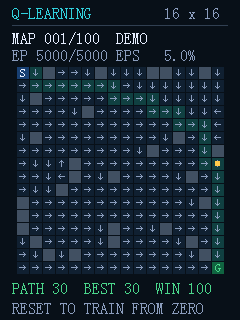
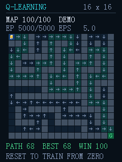

# 16×16 地图库版验证记录

日期：2026-11-12（Asia/Shanghai）。硬件：FK750M6-XBH6 / STM32H750XBH6、SPI200M1 240×320 屏、ST-LINK/V2。默认初始化调用为 `Map_Init(1)`。

## 全部地图的电脑测试

运行 `pwsh -NoProfile -File tools/test.ps1`，结果见 [完整测试输出](maps_native_test.txt)。

- 100 张不同的 16×16 地图，编号连续 1～100。
- 对每张图检查字符、尺寸、起终点、所有路格连通性，以及与其它地图不重复。
- 穷举每张图的状态和动作，验证边界、撞墙、正常移动和终点规则。
- 独立 BFS 计算最短距离，与地图元数据比对；地图库最短距离范围为 30～92 步。
- 每图使用种子 `0x750`、`1`、`42` 各训练 5000 回合，**300/300 次均得到最短路径**。
- 检查路径逐步邻接、不穿墙，Q 值均为有限数，评估不会修改学习器。
- 非法 `Map_Init(0)`、`Map_Init(101)` 返回失败并保留原图。
- 数值测试覆盖终点不 bootstrap、TD 更新、回合截断和重启。

另检查生成器重复运行输出完全相同，C 数组与 JSON 格子逐项一致，离线图册含编号 1～100 的 100 张 SVG 预览。测试结果针对当前地图、种子和超参数；修改奖励或训练预算后应重新验证。

## 实机加载两张不同地图

先将初始化调用改为 `Map_Init(100)` 编译烧录并验证，再恢复 `Map_Init(1)` 编译烧录并验证。当前留在板上运行的是 **1 号地图**。

| 项目 | 001 开放障碍 | 100 长路径迷宫 |
|---|---:|---:|
| 训练回合 | 5000 | 5000 |
| 到达终点回合 | 4944 | 4847 |
| 达到步数上限回合 | 56 | 153 |
| Q-learning 更新次数 | 373,366 | 758,211 |
| 训练时间（含慢速首回合、显示和等待） | 13.068 s | 16.851 s |
| 学到的贪心路径 | 30 步 | 68 步 |
| 独立 BFS 参考距离 | 30 步 | 68 步 |
| 最近 100 回合成功率 | 100% | 100% |
| fatal_count / spi_errors | 0 / 0 | 0 / 0 |

SWD 记录：[001 号训练](board_map001.json)、[100 号训练](board_map100.json)。通过 SWD 从 DTCM 读回 Q 表，独立执行贪心路径检查。训练结束后两张图都进入循环演示。

## 屏幕帧缓冲检查

每格 13×13 像素，16×16 网格占 208×208 像素。界面显示地图编号、训练回合、探索率、最近成功率，以及学到的路径与参考距离。

| 默认 001 号 | 长路径 100 号 |
|---|---|
|  |  |

这些 PNG 来自板上真实 RGB565 帧缓冲，已检查文字和布局；不是物理屏幕照片。100 号截图来自验证中间版本，最终版本在 EPS 数字后补上了百分号。

## 编译和内存

Arm GNU Toolchain 13.3.1，RelWithDebInfo，编译/链接无警告；OpenOCD 烧录读回 `Verified OK`。100 张地图常量共占约 28 KiB，全部放入片内 Flash，运行无需外部 SDRAM。

| 区域 | 使用量 | 容量 |
|---|---:|---:|
| Flash | 57,348 B | 128 KiB |
| DTCM（含预留栈/堆） | 14,592 B | 128 KiB |
| AXI SRAM | 156,032 B | 512 KiB |

Q 表为 `float[256][4]`，占 4096 字节。默认模型仍在 STM32 上从零学习，地图库中没有预训练 Q 表或动作序列。

每次烧录前均保存原有 128 KiB 固件到本机 `logs/before_flash_*.bin`。旧版 8×8 的记录保存在 [历史验证报告](BOARD_VALIDATION_8x8.md)。

最终默认 001 号固件 SHA-256：

```text
84c15fd8bcb57ac63fc40fe19f4b4b19b44f45085dc3175a8572721ee73a1da9
```
