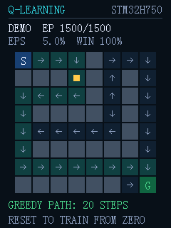

# STM32H750 实机验证记录

验证日期：2026-11-12（Asia/Shanghai）。板卡为 FK750M6-XBH6，ST-LINK/V2，目标电压约 3.28 V。OpenOCD 探测片内 Flash 为 128 KiB，烧录完成后 `Verified OK`。

## 从零训练结果

通过 `python tools/monitor.py --restart --seconds 75 --output logs/board_training.json` 清空 Q 表并连续采样，获得 39 条记录，时间跨度 76.172 秒。完整诊断数据见 [board_training.json](board_training.json)。

| 项目 | 实测结果 |
|---|---:|
| CPU 主频 | 480 MHz |
| 完成训练回合 | 1500 |
| 成功到达终点 | 1436 |
| 达到 256 步上限 | 64 |
| Q-learning 更新次数 | 80,774 |
| 训练阶段时间 | 52.916 秒（包含等待、动画和显示） |
| 最后 100 个训练回合成功率 | 100% |
| 关闭探索后的路径 | 20 步 |
| fatal_count / spi_errors | 0 / 0 |
| 画面生成与 SPI 发送耗时 | 约 21.1 ms/帧 |

训练结束后 Q 表保持不变，板子持续循环演示。后续读取时已完成 39 次演示，仍无程序或 SPI 错误。

实际从板上 DTCM 读回 1024 字节 Q 表，独立按最大 Q 值求出的状态序列为：

```text
0 → 1 → 2 → 3 → 11 → 19 → 18 → 17 → 16 → 24 → 32
  → 40 → 48 → 49 → 50 → 51 → 52 → 53 → 54 → 55 → 63
```

每一步都满足地图邻接规则，无穿墙或循环，与测试中的 BFS 最短距离 20 步一致。

## 画面检查

下图由板上实际 RGB565 帧缓冲读取并转换得到，检查了文字、地图和状态布局。它不是物理 LCD 的照片；SPI 成功返回与画面内存检查不能替代光学检查。



抓取命令（需 Pillow，会短暂停核读取，随后恢复运行）：

```powershell
python tools/snapshot.py --output docs/board_demo.png
```

## 编译与原生测试

Arm GNU Toolchain 13.3.1 / RelWithDebInfo 编译通过，无编译或链接警告。

| 内存区域 | 链接器使用量 | 容量 |
|---|---:|---:|
| Flash | 27,636 B | 128 KiB |
| DTCM（含预留栈/堆） | 10,752 B | 128 KiB |
| AXI SRAM | 155,524 B | 512 KiB |

`tools/test.ps1` 通过：边界和撞墙、终点目标、TD 数值、超时重启、只读评估，以及 **33/33 个随机种子**均学到最短 20 步路径。测试固件没有链接 BFS 代码。

已烧录 `q_learning.bin` 的 SHA-256：

```text
1b52990429de81efafafe06875632d4a076c8f94a42c62e538735120561b5084
```

第一次烧录前的原固件保存在本机 `logs/before_flash_20261112_175007_025.bin`，大小为完整 131,072 字节；相关 SHA-256 与烧录日志也保留在 `logs/`，不纳入 Git。
