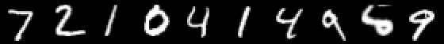
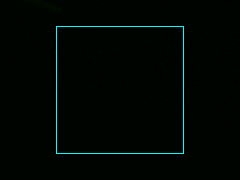

# CNN 手写数字识别首版验证

日期：2026-11-12（Asia/Shanghai）。硬件为 FK750M6-XBH6 / STM32H750XBH6 + OV5640 + SPI200M1，CPU 480 MHz。

## 训练和原生 C 对照

- 固定种子 750，PyTorch 2.15.0+cpu，12 个 epoch。
- MNIST 原始训练集划分为 55,000 张训练、5,000 张验证，按验证集准确率选检查点。
- 独立测试集 10,000 张，正确 9863 张，准确率 98.63%。
- 同一输入下，手写 C 与 PyTorch 的分类结果 10000/10,000 一致，最大 logit 绝对误差 0.00003433。
- 预处理测试使用前 1,000 张测试图，反色/放大成合成白纸黑字，再走真实 C 预处理与 CNN：正确 973 张，97.3%。分母包含预处理失败，不只统计成功定位的样本。
- 均匀白/黑/灰背景被低对比度检查拒识；微小噪点不被当作数字；触碰取景框边缘的笔画会被拒识。

详细数据：[训练报告](../models/training_report.json)、[原生测试](native_validation.json)。

下面是部分合成输入经过 C 预处理得到的 28×28 图像，不是镜头实拍：



## 真实 STM32 推理

- 开机内置 10 类真实测试样本：10/10 类别及 logits 数值检查通过。
- 通过 SWD 依次发送测试集前 100 张已知 28×28 图，真实 Cortex-M7 推理结果与参考预测 100/100 一致。
- 对真实标签正确 99/100；这不是对完整测试集重新统计的结果。
- 单次纯 C FP32 CNN 耗时：最小 7.359 ms，平均 7.36268 ms，最大 7.367 ms。
- 上述计时不包含摄像头预处理、显示和串口/SWD 传输。该测试明确绕过了光学采集与预处理。

详细数据：[板上已知输入测试](board_inference_validation.json)。

## 实时相机与恢复验证

- OV5640 ID 为 0x5640，16 MiB SDRAM 初始化/全空间读写自检通过。
- 末次实时测试窗口约 20.130 秒，实际采集 60.01 FPS，实际预览 29.21 FPS。
- 测试窗口内 fatal / DMA / DCMI / SPI 错误均为 0。
- 预览主动限制在约 30 FPS，因此采集帧跳过属正常调度；复制窗口遇到 DMA 换帧会丢弃不稳定副本并重试，不把竞争数据送入识别。
- SWD 测试和相机副本截图结束后，确认 `input_mode=0`、`frame_frozen=0`，已恢复实时模式。

详细数据：[相机连续运行记录](board_live_validation.json)。

本次真实相机画面很暗，取景框内没有清晰数字，程序拒识。用户暂不方便放置纸面数字，因此**真实纸面准确率、对焦、光照适应性尚未验证**，不将 MNIST 或合成测试成绩当成实拍成绩。



图片通过 SWD 从板上稳定 CPU 帧副本读取，含取景框；不是屏幕的光学照片。

## 构建与内存

GCC 13.3.1 / RelWithDebInfo，最终固件编译链接无警告，OpenOCD 烧录并读回 `Verified OK`。

| 区域 | 使用量 | 容量 |
|---|---:|---:|
| Flash | 94,776 B | 128 KiB |
| DTCM（含预留栈/堆、诊断、CNN 工作区） | 41,696 B | 128 KiB |
| AXI SRAM | 164,164 B | 512 KiB |
| 外部 SDRAM 帧缓存 | 172,800 B | 16 MiB |

最终 `digit_cnn.bin` SHA-256：

```text
88d7ade3f632b89186d9ebe63742e133cf1ee70c293dae553bde0b0d3a5dd03e
```

原强化学习工程迁移后重新构建，300 次地图训练测试仍全部通过；其 BIN SHA-256 与迁移前一致，目录调整没有改变原固件行为。原工程与每次刷写前的备份均保存在本机。
