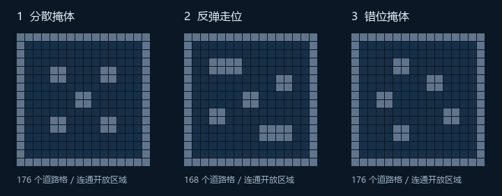

# STM32 坦克掩体竞技场

独立运行于 **FK750M6-XBH6 / STM32H750XBH6 + 2.00 寸 240×320 SPI 屏**。训练、物理仿真和显示都在单片机上完成，不需要串口或电脑参与运行。

蓝方使用 Q-learning，红方使用固定规则。地图采用分散掩体和宽阔走位区，保留 16 向反弹弹道；**车弹标称同速，移动和射击可以同时进行，每 0.5 秒允许再发一颗，不必等待旧弹消失。**

## 当前玩法

- 100 ms 一个仿真拍：坦克最多移动一格，弹丸沿归一化方向飞行同样的距离。
- 炮塔自动从 16 档方向中选择直射或反弹射击解，弹丸发射后不追踪目标。
- 每方独立 500 ms 冷却，最多容纳 16 颗同时活动的弹丸。
- 前两次撞墙反弹，第 3 次撞墙消失；反弹后可以伤到发射者。
- 同时移动、逐段命中，双方同拍被击中判平局；单次命中结束回合。
- 出生点至少间隔 8 格路径，留出展开和躲避时间。
- 200 拍采样上限，超时计平局。

屏幕中的 `AMMO 蓝/红` 是双方当前在飞弹丸数，`1:1` 表示车弹速度比。反弹弹丸带金色边缘；出现反弹击杀时显示 `BANK WIN`。

## 专用掩体地图



| 编号 | 地图 | 可行走格 | 设计 |
|---|---|---:|---|
| 1（默认） | COVER ISLANDS | 176 | 五块独立掩体、环形绕行、外围反弹墙 |
| 2 | BANK SHOT | 168 | 长短掩体组合、错开的反弹射击面 |
| 3 | SCATTER | 176 | 分散错位掩体、更多斜向射击路线 |

三张地图的道路全部连通，每个道路格都属于至少一个 2×2 的开放区域。主要布局留有多格宽通道，避免旧寻路迷宫中大量单格窄路。

换图在 [Core/Src/tank_app.c](Core/Src/tank_app.c) 的初始化函数中修改：

```c
if (!Arena_Init(&g_world, 1)) Error_Handler();
```

编号为 1～3，改完重新编译烧录，从零学习对应地图。当前默认训练预算的性能仅对已验证场景成立。

## 上电流程

1. 检查板载 16 MiB SDRAM，清空学习经验。
2. 测量随机蓝方的基线，播放两局随机对战。
3. 在板上加速训练 60,000 回合，显示探索率、最近胜率和进度。
4. 关闭探索，使用独立出生序列评估 500 局。
5. 自动循环对战，显示 `BASE …% -> RL …%`。

按板子 **RESET** 可重新训练。学习表保存在 SDRAM，断电不会保留，没有向板上导入预训练策略。

## 开火与瞄准策略

双方共用射击几何计算：预先追踪各方向的反弹路径，为静态目标格记录较短、较安全的射击解。炮塔在开火时选择方向，之后弹丸只受碰撞反射影响。它能提供反弹机会，但不会保证打中正在移动的目标。

红方固定规则在冷却就绪时积极发射，并在接近对手时做局部避弹；它不预知还没发生的反弹。蓝方有 10 个动作：四向移动/等待，以及同样的五个动作加开火，因此能边走边射。

蓝方对未学习的带开火动作采用小的初始偏好，冷却就绪却长期不射击会有节奏代价。开火奖励上限低于持续时间代价，胜负奖励仍占主导，不能靠原地刷射击获得正回报。

## 修改固定红方策略

策略独立在 [Game/fixed_policy.c](Game/fixed_policy.c)，声明在 [Game/fixed_policy.h](Game/fixed_policy.h)。

```c
uint32_t FixedPolicy_Decide(const FixedPolicyInput *input);
```

输入为只读地图、当前拍开始前状态和阶段；输出为 0～9 的移动/开火动作。做鲁棒性实验时，只修改 `challenge_config` 或 `challenge_policy()`：训练继续使用不变的 `reference_policy()`，评估与演示使用你改过的挑战对手。

[完整输入输出、动作表、冷却时序与可替换示例](docs/FIXED_POLICY_API.md)。默认配置与拆分前行为一致。改好后运行原生测试、重新编译烧录即可；复位仍会从零经验重新训练。

## 强化学习表示

多颗弹丸的精确连续坐标无法实用地逐项枚举。本版使用**战术观测聚合**：掩体/路径方向、敌方相对方位与距离、射击机会、冷却就绪、近两拍来弹风险和弹幕密度。

这是近似、部分可观测的表示，不再宣称旧版本“完整物理状态键”的马尔可夫性质。动作由 Q 值决定；观测中的路径和风险特征属于人工设计的输入。相关代码及限制见 [学习说明](docs/LEARNING_GUIDE.md)。

稀疏学习表占 **7 MiB SDRAM**，最多 131,072 个槽，每槽保存观测键、10 个动作值和访问次数。比较完整观测键后才复用条目；局部满时替换低访问条目。

## 编译、烧录与验证

在 VS Code 打开本目录，使用 `build`、`flash ST-Link` 任务，或运行：

```powershell
pwsh -NoProfile -File tools/build.ps1
pwsh -NoProfile -File tools/flash.ps1
```

工具链位于本机 `D:/STM32Tools`。烧录脚本先备份现有 128 KiB Flash 到本机 `logs/`，再烧录并读回验证。

```powershell
pwsh -NoProfile -File tools/test.ps1
python tools/monitor.py --seconds 300 --until-demo
python tools/snapshot.py --wait-multi --output logs/multi.png
```

验证工具仅在开发时通过 ST-LINK/SWD 工作，不使用 UART。原生测试使用与固件相同的 C 代码，覆盖车弹同速、500 ms 多弹连发、移动加开火、第三次墙碰消失、反弹击杀、地图空间和多种子学习对照。

板上本次训练约 62.8 秒，500 局评估胜率从 17.4% 提升到 64.4%，已实际出现双方反弹击杀。

实际训练数据、开火统计和板上画面见 [验证记录](docs/VALIDATION.md)。新地图、同速多弹和更积极的固定对手改变了任务，胜率不能直接与旧窄迷宫版本比较。

## 硬件与源码

需要带 32 位 SDRAM 的 M6 核心板。LCD SCK=PG13、MOSI=PG14、CS=PA15、DC=PG12、背光=PH6。ST-LINK 使用 PA13/PA14、GND 和目标参考电压。

- [Game/arena_maps.c](Game/arena_maps.c)：三张专用掩体竞技场。
- [Game/battle.c](Game/battle.c)：500 ms 冷却、多弹池、等速飞行、反弹解和战术观测。
- [Game/fixed_policy.c](Game/fixed_policy.c)：可单独修改的红方固定策略、训练/挑战配置。
- [Learning/tank_agent.c](Learning/tank_agent.c)：进攻性初值、稀疏 Q-learning、只读评估。
- [Core/Src/tank_app.c](Core/Src/tank_app.c)：板上训练/评估/演示和固定时间步。
- [Core/Src/tank_display.c](Core/Src/tank_display.c)：掩体、炮塔、弹幕、冷却和胜负显示。

第三方板级代码来源见 [THIRD_PARTY.md](THIRD_PARTY.md)。
