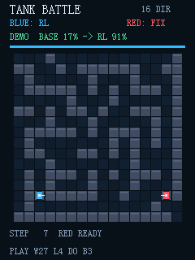
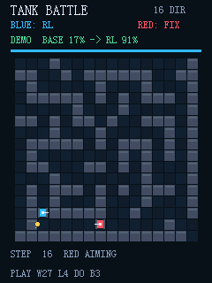

# 16 方向飞弹 + 复杂迷宫实机验证

日期：2026-11-16（Asia/Shanghai）。硬件为 FK750M6-XBH6 / STM32H750XBH6 @480 MHz、16 MiB SDRAM、SPI200M1 240×320 屏和 ST-LINK/V2。运行与训练都在 STM32，不使用串口。

## 最终实现

- 默认 75 号 16×16 回路迷宫，145 个道路格、111 个墙格，全部道路连通。
- 蓝方板上 Q-learning，红方固定寻路和四拍射击节奏。
- 自动瞄准 16 档方向，子弹发射后方向固定，保留 1/16 格细分坐标。
- 每拍四个约半格的子步，线段扫掠检查命中，避免高速漏检。
- 前两次撞墙反弹，第 3 次撞墙消失；水平/垂直墙反射对应速度分量。
- 未反弹的自弹有炮口保护；反弹后可以伤到发射者。双方各最多一颗在飞子弹。
- 同步动作、一击结束、同时命中判平，160 拍超时采样截断。

这里仍为离散街机物理，16 档整数速度矢量有少量角度/速度量化误差；不是连续任意角度的刚体仿真。学习者控制移动、等待和开火时机，炮塔方向由自动瞄准确定。

## 原生 C 规则与学习测试

`tools/test.ps1` 编译与固件相同的 C 源码。规则测试覆盖：

- 开火后实际飞行，不瞬时命中；发射后不追踪目标。
- 非 45° 斜向的细分坐标、墙面/角点反射、第三次碰撞消失。
- 飞行时间与碰撞次数分开；弹仓占用不重置在飞弹丸。
- 侧移、反弹自伤、逐段命中、同步移动冲突、双方命中判平。
- 状态键包含细分位置、方向和碰撞计数，忽略非活动子弹的残留字段。
- 终点不 bootstrap、超时截断仍 bootstrap，Q 值有限。
- 评估不更新 Q 表、访问次数和训练 RNG。

完整输出见 [native_test_results.txt](native_test_results.txt)。每个种子从零训练 60,000 回合，再用独立出生序列评估 1,000 局：

| 种子 | 随机基线胜/负/平 | 学习后胜/负/平 | 学习后胜率 |
|---|---|---|---:|
| 750 | 186 / 791 / 23 | 905 / 94 / 1 | 90.5% |
| 1 | 186 / 791 / 23 | 911 / 88 / 1 | 91.1% |
| 42 | 186 / 791 / 23 | 916 / 82 / 2 | 91.6% |

## STM32 从零训练

首条 SWD 记录确认 `episodes=0`、`q_used=0`，随后观察到训练、评估和自主对战。没有从电脑传入模型或经验。

| 项目 | 实测 |
|---|---:|
| 训练回合 | 60,000 |
| Q 更新次数 | 538,729 |
| 训练阶段时间 | 13.639 秒（包含显示/调度） |
| 随机基线（500 局） | 胜 85 / 负 404 / 平 11 |
| 学习后评估（500 局） | 胜 457 / 负 42 / 平 1 |
| 胜率 | 17.0% → 91.4% |
| Q 表条目 | 101,004 / 262,144 |
| Q 表替换 | 5 |
| fatal / SPI 错误 | 0 / 0 |

完整数据：[board_training.json](board_training.json)。演示使用不同出生序列，实际发生过蓝方失败，胜负不是预先播放的答案。不同编译器的浮点舍入可能使学习轨迹略有差异。

## 实机帧缓冲





反弹截图的诊断确认有一颗活动弹丸已经碰撞 1 次，画面中以金色边缘显示。PNG 由实际板上 RGB565 帧缓冲经 SWD 读取，不是物理屏幕照片；抓取前按当前状态重画并短暂冻结，结束自动恢复。

## 内存与烧录

GCC 13.3.1 / RelWithDebInfo，编译链接无警告，OpenOCD 烧录读回 `Verified OK`。每次烧录前备份了原有完整 128 KiB Flash 到本机 `logs/`。

| 区域 | 使用 | 容量 |
|---|---:|---:|
| Flash | 64,164 B | 128 KiB |
| DTCM（含栈/堆预留） | 9,504 B | 128 KiB |
| AXI SRAM | 357,532 B | 512 KiB |
| SDRAM 稀疏 Q 表 | 10,485,760 B | 16 MiB |

最终 BIN SHA-256：

```text
c2c14bd8fff8a334d453501ed6f5b5db59833d6918b3d7cba5f157397bd02623
```

## 实验范围

结果针对当前地图、固定对手和规定出生分布。红方射击窗口是难度设置，不宣称对称自博弈或跨地图通用能力。有限容量的稀疏 Q 表可能遗忘，换图或增强对手后应重新评估。
